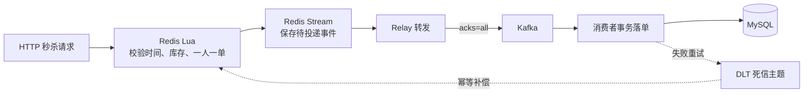
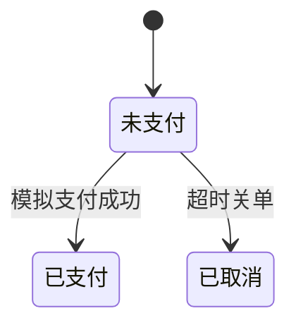

<div align="center">

# 🏙️ 邻享生活 · NeighborLife

基于 Spring Boot 的本地生活平台工程化实践


</div>

> [!NOTE]
> 本项目基于“黑马点评”课程项目进行工程化改造，重点实践高并发下单、消息可靠投递、缓存一致性与接口保护。面试或简历中应如实说明项目来源，并重点讲清自己的改进与取舍。

## 📖 项目简介

NeighborLife 面向本地生活场景，提供商铺查询、优惠券秒杀、博客互动等功能。项目没有单纯堆叠中间件，而是围绕真实失败场景完善秒杀链路、订单生命周期、两级缓存和服务保护。

### ✨ 核心亮点

| 能力 | 实现方案 | 解决的问题 |
| --- | --- | --- |
| ⚡ 异步秒杀 | Redis Lua + Redis Stream + Kafka | 防超卖、一人一单、流量削峰 |
| 📦 订单治理 | 状态机 + Spring Task + 幂等补偿 | 支付/关单竞争、超时未支付订单 |
| 🧱 两级缓存 | Caffeine + Redis + MySQL | 热点访问、缓存穿透与击穿 |
| 🔄 缓存一致性 | 事务提交后删除 + Kafka 延迟二次失效 + TTL | 数据库与缓存短暂不一致 |
| 🛡️ 接口限流 | Redis ZSet + Lua + AOP 注解 | 全局、IP、用户多维限流 |

## 🧰 技术栈

`Spring Boot` · `MyBatis-Plus` · `MySQL` · `Redis` · `Lua` · `Kafka` · `Caffeine` · `Redisson` · `Spring AOP` · `Docker Compose`

项目以 Java 8 为编译目标，因此 Caffeine 使用 2.9.3；运行建议使用 JDK 8、11 或 17。

## 🏗️ 核心架构

### ⚡ 秒杀异步下单



- HTTP 线程不直接写 MySQL，降低秒杀流量对数据库的冲击。
- Redis Stream 作为待投递消息表，避免预扣成功后应用宕机造成事件丢失。
- Kafka 生产者开启幂等与 `acks=all`，消费失败自动重试并进入死信主题。
- MySQL 事务、条件扣减和 `(user_id, voucher_id)` 唯一索引共同兜底。

### 📦 订单状态机与超时关单



- 支付和定时关单均使用带旧状态的条件更新，保证并发时只有一方成功。
- Spring Task 分批扫描超时订单并恢复 MySQL 库存。
- Lua 通过订单补偿标记幂等恢复 Redis 库存，补偿失败由定时任务继续重试。
- `POST /voucher-order/{id}/pay` 仅演示状态流转，未接入真实支付平台。

### 🧱 Caffeine + Redis 两级缓存

```text
请求 -> Caffeine 本地缓存 -> Redis 分布式缓存 -> MySQL
```

- 空值缓存阻止不存在的店铺请求持续穿透 MySQL。
- 逻辑过期配合互斥重建保护热点 Key，并保留物理 TTL 兜底。
- Lua 比较锁标识后释放锁，避免误删其他线程持有的锁。
- 商铺更新提交后立即删除两级缓存，再通过 Kafka 延迟二次失效。

### 🛡️ 多维滑动窗口限流

- 自定义 `@SlidingWindowRateLimit` 注解与 Spring AOP 切面。
- Redis ZSet + Lua 基于 Redis 服务器时间原子检查多个维度。
- 秒杀接口支持全局、IP、用户限额；热门博客接口支持全局、IP 限额。

## 🚀 快速开始

### 1️⃣ 环境要求

| 环境 | 建议版本 |
| --- | --- |
| JDK | 8+，推荐 17 |
| Maven | 3.6+ |
| MySQL | 5.7+ / 8.x |
| Redis | 5.0+ |
| Kafka | 3.9.2 |
| Docker | 可选，用于在 Linux 虚拟机中运行 Kafka |

### 2️⃣ 初始化数据库

新数据库直接导入：

```text
src/main/resources/db/hmdp.sql
```

旧版课程数据库按顺序执行迁移：

```text
src/main/resources/db/migration/V2__voucher_order_unique_index.sql
src/main/resources/db/migration/V3__voucher_order_lifecycle.sql
```

### 3️⃣ 启动 Kafka

将 `docker-compose.kafka.yml` 放到 Linux 虚拟机。若虚拟机 IP 与默认值不同，先设置：

```bash
export KAFKA_ADVERTISED_HOST=你的虚拟机IP
```

启动并检查：

```bash
docker compose -f docker-compose.kafka.yml up -d
docker compose -f docker-compose.kafka.yml ps
```

停止服务：

```bash
docker compose -f docker-compose.kafka.yml down
```

命名卷 `kafka-data` 会继续保留消息数据。

### 4️⃣ 配置本地环境

真实密码不进入 Git。参考 `.env.example`，在 VS Code 启动配置或系统环境变量中设置：

```text
MYSQL_PASSWORD=你的MySQL密码
REDIS_HOST=你的虚拟机IP
REDIS_PASSWORD=你的Redis密码
KAFKA_BOOTSTRAP_SERVERS=你的虚拟机IP:9092
```

多实例启动时，为每个实例配置不同的 `APP_INSTANCE_ID`。

### 5️⃣ 编译并运行

```bash
mvn clean package -DskipTests
java -jar target/neighbor-life-0.0.1-SNAPSHOT.jar
```

服务默认运行在 `http://localhost:8081`。

## 🗂️ 关键代码导航

| 文件 / 类 | 职责 |
| --- | --- |
| `seckill.lua` | 原子校验活动窗口、库存、一人一单并写入 Stream |
| `VoucherOrderOutboxRelay` | 将 Redis Stream 事件可靠转发至 Kafka |
| `VoucherOrderKafkaConsumer` | 消费订单、失败重试与 DLT 补偿 |
| `VoucherOrderCloseTask` | 超时关单和 Redis 库存补偿重试 |
| `CacheClient` | 空值缓存、逻辑过期和热点缓存重建 |
| `ShopCacheInvalidationHandler` | 两级缓存失效与 Kafka 延迟二次删除 |
| `SlidingWindowRateLimitAspect` | 全局、IP、用户多维滑动窗口限流 |

## ✅ 联调验证

- [x] Redis Lua 预扣后，订单经 Redis Stream 与 Kafka 异步写入 MySQL
- [x] 重复下单被拦截，数据库唯一索引正常兜底
- [x] 未支付订单自动关闭，MySQL/Redis 库存只补偿一次
- [x] 已支付订单不会被定时任务错误关闭
- [x] 不存在的店铺连续查询只访问数据库一次
- [x] 店铺更新后，Kafka 完成延迟二次缓存失效
- [x] 热门博客接口超过 IP 阈值后触发限流

## 💼 简历描述参考

- 使用 Redis + Lua 原子完成活动窗口、库存与一人一单校验，通过 Redis Stream 可靠转发至 Kafka 实现异步削峰；消费端结合 MySQL 事务、唯一索引、重试、死信队列和补偿机制保障最终一致性。
- 设计未支付、已支付、已取消订单状态机，使用条件更新解决支付与关单并发竞争，通过 Spring Task 实现超时关单及幂等库存补偿。
- 使用 Caffeine 与 Redis 构建两级缓存，通过空值缓存防穿透、逻辑过期与互斥重建防击穿，并以事务提交后删除、Kafka 延迟二次失效和 TTL 兜底改善缓存一致性。
- 基于 Redis ZSet、Lua、AOP 与自定义注解实现全局、IP、用户多维滑动窗口限流。

---

<div align="center">

如果这个学习项目对你有帮助，欢迎 ⭐ Star。

</div>
