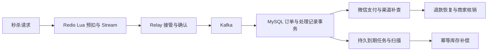

> 本机环境已配置：请先阅读 [本机环境说明](本机环境说明.md)，使用 `./dev.sh start` 启动，`./dev.sh status` 自检，`./dev.sh stop` 停止。

# 邻享生活 · NeighborLife

基于 Spring Boot 的本地生活后端，涵盖商铺、优惠券、秒杀订单、微信支付与退款、到店核销、笔记互动及运营管理。项目保留 Java 8 编译目标、Spring Boot 2.3.12 和 MyBatis-Plus 3.4.3，本机与 CI 使用 JDK 11。

- [功能改造与验收记录](docs/enterprise-review.md)
- [接口约定](docs/api.md)
- [部署与运维](docs/deployment.md)
- [简历技术核查与框架升级方案](docs/technology-review.md)

## 业务与工程能力

| 范围 | 已实现能力 |
| --- | --- |
| 账号 | 阿里云短信、发送回执、手机号冷却、验证码错误次数与一次性消费、登录续期、退出、个人资料 |
| 商铺与券 | 管理员与商家归属、字段白名单、券上下架、价格快照、商铺和券详情两级缓存 |
| 秒杀 | Redis Lua 原子预扣、Stream 持久待投递、Kafka 消峰、数据库唯一约束、排队/失败查询 |
| 交易 | 微信 Native 下单、签名验证与通知解密、金额/商户校验、渠道补查、到期关单、持久退款任务、短期核销凭证 |
| 社交 | 幂等关注/点赞、可恢复粉丝投递、游标分页、评论回复/点赞/举报/审核 |
| 运营 | RBAC、权限实时撤销、变更审计、异常消息隔离重放、离线活动库存对账与重建 |
| 交付 | Flyway、P3C 门禁、OpenAPI、请求追踪、健康检查、Prometheus、容器和 Kubernetes 模板 |



## 本机启动

已配置的工作区：

```bash
./dev.sh build
./dev.sh start
./dev.sh status
./dev.sh stop
```

本机脚本加载 `.env`，启动项目 MySQL/Kafka，使用系统 Redis 的独立 DB 1。普通启动默认模拟短信与支付；完整验收使用强制模拟模式的专用启动器，详见验收文档。

其他环境先创建空的 MySQL 数据库和应用账号，按 [.env.example](.env.example) 设置连接参数，启动 Redis 与 Kafka：

```bash
mvn -B -ntp -Pquality verify
java -Duser.timezone=Asia/Shanghai -jar target/neighbor-life-0.0.1-SNAPSHOT.jar
```

Flyway 自动初始化空库。旧库升级步骤见部署文档。JDK 11、MySQL 8.4、Redis 6.2+、Kafka 3.9.2 为部署基线；本机现有 MySQL 8.0.46 的兼容性也已回归。

- 商铺查询：`GET /shop/1`
- 优惠券详情：`GET /voucher/{id}`
- 本地 OpenAPI：`/v3/api-docs`、`/swagger-ui.html`
- 健康检查：`/actuator/health/readiness`

登录使用 `Authorization: <token>`。Long ID 以 JSON 字符串返回。支付和短信的通用配置默认为 `disabled`；真实渠道通过 `PAYMENT_MODE=wechat`、`SMS_MODE=aliyun` 启用，生产 profile 强制真实渠道。商户证书、API v3 密钥、阿里云凭证及已审核短信模板配置见 [部署环境模板](deploy/application.env.example)。

## 回归

```bash
mvn -B -ntp -Pquality verify
# 指向专用测试数据库时启用事务集成测试
RUN_MYSQL_INTEGRATION=true mvn -B -ntp -Pquality verify
python scripts/verify_lua.py
python scripts/verify_redis_failover.py
```

P3C 覆盖官方全部 10 组规则及生产/测试源码，违规会阻断构建。CI 使用 MySQL 8.4 空库执行自动迁移及事务测试；结果报告分别位于 `target/pmd.xml` 和 `target/surefire-reports/`。本机完整验收、容量测试、Kafka 故障转移与备份恢复命令见 [验收记录](docs/enterprise-review.md)。
